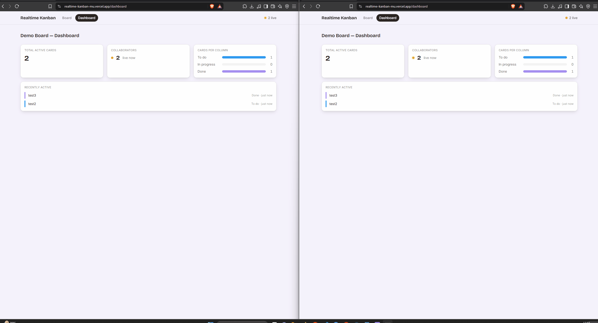

# realtime-kanban

A real-time collaborative Kanban board demonstrating two concurrency
strategies side by side: last-write-wins (LWW) registers for
single-value fields, and CRDTs (Yjs) for concurrent list ordering.

**Live demo:** https://realtime-kanban-mu.vercel.app



**Status: the core real-time loop is built and verified — board UI,
WebSocket client, LWW mutations, CRDT card ordering, tombstoned
deletes, sync-on-connect for late joiners, Postgres persistence, and
lightweight per-tab presence, and a durable offline queue all work end
to end.** Auth and column management UI are the remaining gaps (see
below).

## Architecture

- **`apps/web`** — Next.js App Router frontend, Tailwind CSS.
- **`apps/server`** — Node WebSocket server. Separate from `web` on
  purpose: persistent WebSocket connections don't survive on
  serverless platforms like Vercel, so the realtime layer has to be
  its own deployable process.
- **`packages/shared-types`** — the wire protocol and domain model,
  compiled to `dist/` and consumed by both apps as real `.js` output
  (see "Why shared-types is compiled" below — this wasn't the
  original design, it's a fix for a real bug).

## Running this locally

```bash
npm install
npm run build:shared-types   # required before first run, and after
                               # any edit to packages/shared-types
docker compose up -d          # local Postgres for apps/server
npm run prisma:generate --workspace=apps/server
npm run prisma:migrate --workspace=apps/server   # first run only, creates the schema
npm run dev:server            # apps/server, ws://localhost:4001
npm run dev:web                # apps/web, http://localhost:3000
```

Open `http://localhost:3000` in two browser tabs side by side. Add a
card in one tab — it appears in the other. Drag a card between
columns or reorder it within a column — both tabs converge to the
same order, with a drop-zone highlight showing where the card will
land. Edit a card's title concurrently in both tabs — one edit wins
deterministically (LWW), not just "whichever saved last." Click into
a card to edit it in one tab — the other tab shows a small colored
name badge on that card for as long as you're editing.

**If you're actively editing `packages/shared-types`**, run
`npm run dev --workspace=packages/shared-types` in a separate
terminal (a `tsc --watch`) so `apps/server` and `apps/web` pick up
changes without you remembering to rebuild manually each time.

## Why shared-types is compiled, not imported as raw source

Originally `apps/server` and `apps/web` both imported
`shared-types`' `.ts` source directly. That broke in two opposite
directions at once: `apps/server` runs via `tsx`, which uses Node's
real ESM loader and requires relative imports to end in `.js` even
when the file is `.ts`. Turbopack (bundling `shared-types` for the
browser) couldn't resolve that same `.js`-pointing-to-`.ts`
convention and failed with "module has no exports at all." Neither
import style satisfied both consumers — so the fix isn't an import
style, it's not shipping raw source to either side. `shared-types`
now compiles to `dist/index.js` + `.d.ts`, and both apps import that,
same as they'd import any other real npm package.

## Sync strategy per field

| Field | Strategy |
|---|---|
| `Board.name`, `Column.title` | LWW |
| `Card.title`, `Card.description`, `Card.columnId` | LWW |
| `Card.position` (ordering) | Yjs `Y.Array`, one per column |
| `Column.order` | Fixed at seed time — no reordering UI yet |

**Why `Card.position` gets CRDT treatment and `Column.order`
doesn't:** card drags are the highest-frequency interaction and the
one worth demonstrating the LWW failure mode on. Column reorders are
rare and there's no UI for adding/removing columns yet — three fixed
columns (`To do` / `In progress` / `Done`) are seeded on first server
start.

**LWW tie-breaking:** every field mutation carries a Lamport clock
(`{ lamport, clientId }`), not a wall-clock timestamp. Higher
`lamport` wins; ties break on `clientId`. Every replica runs the same
`isNewer()` (it lives in `packages/shared-types`): the server on the way
in, and each client against its own per-field clock map when applying a
remote write, so a stale write is ignored wherever it comes from. The
map is seeded from `SYNC_RESPONSE.fieldClocks`, and a client advances its
own counter past every clock it receives, so an edit made after seeing
someone else's can't stamp a lower clock and lose to it.

**Tombstones:** deletes never remove a row — they set `deletedAt`.
Delete wins unconditionally: a concurrent edit to a tombstoned card
is dropped even if its clock is newer.

**CRDT updates over the wire:** JSON can't carry a raw `Uint8Array`,
so `Y.encodeStateAsUpdate`'s output is base64-encoded before sending
(see `packages/shared-types/src/binary.ts`) and decoded on receipt.
This trades ~33% size overhead for not needing binary WebSocket
frames — an acceptable tradeoff at this scale.

**Sync-on-connect:** a client sends `SYNC_REQUEST` on connecting; the
server replies with every board/column/non-tombstoned-card plus each
column's full CRDT state, so a client joining mid-session sees
current state immediately instead of waiting for the next edit.

**Offline queue:** while the socket isn't open, outbound `MUTATE`,
`CREATE`, `DELETE`, and `CRDT_UPDATE` messages are queued durably in
IndexedDB (`apps/web/lib/offline-queue.ts`) instead of being dropped.
Each queued entry gets a `messageId` (a UUID, made once when it's
queued and stored with it, so every replay reuses it). On reconnect the
client sends `SYNC_REQUEST` first, then replays the queue in insertion
order. The server answers each message that carries a `messageId` with
`ACK {messageId}` (to the sender only), once it has handled it and its
DB writes have settled; the client deletes the entry **when the ACK
arrives, not when it's sent**. An entry that is sent but never ACKed
(socket dropped, tab closed) is sent again on the next connection or
page load, under the same `messageId`. Entries left in IndexedDB by an
older client have no `messageId`, are never ACKed, and are still deleted
as soon as they're sent. The same applies to a server that doesn't ACK:
every `SYNC_RESPONSE` carries `acks: true` from a server that does, and
a client assumes ACK support on a new socket only until that socket's
first `SYNC_RESPONSE`. If that response lacks the flag (a server from
before ACKs), the client counts what it already sent on that socket as
delivered, deletes those entries, releases the drain lock, and uses
delete-on-send for that socket; the decision is made once per socket and
reset when it closes. If the server can never accept a message (it's
invalid, or handling it throws) it ACKs with an `error` and the client
drops the entry instead of replaying it forever.
`PRESENCE` is not queued — it's ephemeral and sent fresh on connect.
The top bar shows "Offline — N pending" (or "Syncing — N pending"
while draining or waiting for ACKs) until the queue is empty.

Two tabs share one IndexedDB store, so a drain holds a Web Lock until
every entry it sent has been ACKed or its socket has closed. A lock
(rather than an "in flight" marker in IndexedDB) is released by the
browser the moment its tab dies, so a crashed tab can never leave an
entry stuck as another tab's; the cost is that the second tab waits out
the first one's ACK round trip.

## Delivery and convergence: what the tests prove

**Delivery: at-least-once, with idempotent handlers — for queued
messages.** A message that goes through the queue (sent while offline, or
while earlier entries are still queued or awaiting their ACK) is retained
until the server ACKs it, so it is delivered at least once; because a
replay can therefore arrive more than once, every durable handler is safe
to run twice. This is not exactly-once. Each of these is covered by a test
that drives the real server over a real WebSocket
(`apps/server/src/ack.e2e.test.ts`, `create-idempotency.e2e.test.ts`):

- `CREATE` for an id the server already has — live or tombstoned,
  including after a restart — is ignored: no overwrite, no DB write, no
  rebroadcast. A replay of a live card's `CREATE` is still ACKed.
- `DELETE` of an already-tombstoned card is ignored: `deletedAt` isn't
  re-stamped, nothing is written, nothing is rebroadcast.
- `MUTATE` replayed with an identical clock is a no-op (not newer than
  itself); a stale one is rejected. Both are ACKed.
- `CRDT_UPDATE` replayed leaves one copy of the card in the column order.
- A message with no `messageId` is still accepted and never ACKed; the
  `messageId` isn't relayed to other clients.

**Convergence: shown for one field, one peer, three interleavings.**
`apps/web/lib/convergence.e2e.test.tsx` runs the real client
(`BoardProvider` + `WsClient`) against the real server and one other
peer, editing the same card title: (1) the other peer's edit has the
higher clock and reaches the server first; (2) it has the lower clock and
reaches the server first; (3) the client edits after seeing the other
peer's edit. In all three, what the client displays equals the server's
value. The server sends no "you lost" reply — the client's own clock
check is what does it. Not shown: three or more clients, fields other than
`title` end to end (`description` and `columnId` use the same code path
but have no end-to-end test), network partitions, or CRDT card ordering
end to end (the Yjs guarantee itself is tested at the library level in
`concurrency.test.ts`).

## Property and browser tests

**Property tests** (`apps/web/lib/*.property.test.ts`, fast-check) generate
many random scenarios and check an invariant on each, instead of a few
hand-picked ones.

- `lww-convergence.property.test.ts` — random `MUTATE`s (fields, lamports,
  client ids, with ties common) delivered to two server replicas (the real
  `applyMutation`, Prisma stubbed) and two client replicas (the real
  `FieldClocks`) in random orders with duplicates. All end identical, and
  identical to the highest-clock write per field — checked against a
  comparator written separately from `isNewer`, because agreement alone is
  satisfied by a consistently *wrong* rule (flipping `isNewer` to prefer the
  lower clock keeps every replica in agreement; only the winner check
  fails). The DB stub shows the server's queued writes end on the same
  winner. Not covered: the network, real persistence, tombstones (the
  server drops edits to a deleted card above `applyMutation`), the rest of
  the client (SYNC resets, the reducer), and equal clocks with different
  values (no real sender produces them).
- `yjs-ordering.property.test.ts` — random creates and moves, using the
  Yjs steps `createCard`/`moveCard` perform (copied: they live inside a
  React hook), made concurrently by 2–3 replicas and merged in random
  orders, with and without per-sender ordering, plus a server doc and a late
  joiner. All converge, no card is lost, and when each card is moved by one
  replica only every card appears exactly once. Not covered: the network,
  Postgres, tombstones, and whether the resulting order is what a user meant.

**Browser tests** (`apps/e2e`, Playwright, Chromium) run against localhost
only: the web app is built with `NEXT_PUBLIC_WS_URL` pointing at the test
server (Next inlines it at build time), `next start` serves it, and each
test starts the real server process on a throwaway `kanban_e2e_*` database
at a fixed port (default 4101; the web app on 3101; `E2E_WS_PORT` /
`E2E_WEB_PORT` change them). A page's http(s) request to any host but
loopback is blocked, and that (or a WebSocket to one) fails the test; the
harness refuses `APP_ENV=production`, a non-local `DATABASE_URL`, or a port
that already has a listener. (The build itself fetches the Google fonts
`layout.tsx` asks for, as any `next build` does.) `npm run test:e2e
--workspace=apps/e2e`; the build writes `apps/web/.next`.

- `concurrent-edit.spec.ts` — two contexts edit one card's title while
  each page's incoming `MUTATE`s are held, so the edits are concurrent by
  construction; the edit that arrives last at the server has the lower
  clock. Both screens and Postgres end on the higher-clock title. Only
  the title, two browsers, no ties, no deletes.
- `offline-queue.spec.ts` — two pages of one context (real IndexedDB, real
  Web Locks) queue six entries while the server process is stopped; it is
  restarted; every `messageId` is sent exactly once across both pages
  (counted from the frames), the outbox ends empty, and both screens and
  Postgres hold the same board with the LWW winner of a rename both made.
  Without `navigator.locks` every entry goes out twice, so the count is
  not vacuous. Not covered: a tab dying or the server dying mid-drain, more
  than two pages, queued deletes, reloads.

## CI

`.github/workflows/ci.yml` runs on every push and pull request, on Node 24
(the major version used locally; one `NODE_VERSION` at the top). The
`checks` job: `npm ci`, `build:shared-types`, `prisma generate`, `tsc` for
`apps/server` and `apps/web`, `typecheck:tests`, the browser tests' own
typecheck, `prisma migrate deploy` against a Postgres 16 service container,
then both test suites. The `browser` job installs Chromium and runs
Playwright. Only `checks` sets `REQUIRE_DB=1` (it is set nowhere else), so
there the seed-order and e2e suites fail instead of skipping when no
localhost database is configured. The database credentials in the file are
for the job's throwaway container; there are no secrets, and `APP_ENV` is
never set.

## Input validation and limits

Every frame the server reads goes through four steps, in this order, before
any handler runs (`apps/server/src/index.ts`, `processFrame`):

1. **Rate limit** (below) — a frame is handled at once or delayed in order.
2. **Schema** — one Zod schema per `ClientMessage` type in
   `packages/shared-types/src/schema.ts` (`parseClientMessage`), shared so
   client tests can run the same check. Required fields are strict.
   **Unknown extra fields are stripped, not rejected**, so an older cached
   client, or a newer one, isn't locked out; the stripped copy is what gets
   handled and relayed. `entityType` must be `board`/`column`/`card`; `MUTATE`
   and `CREATE` require a `clock` (a `DELETE`'s clock is never read, so it
   stays optional, but must be well-formed if present); a `field` must be a
   plain identifier (it becomes a property name); a `MUTATE` value is a
   string, number, boolean or null; `CREATE`'s `initialValues` are checked per
   entity type and keys that aren't columns of it (including `id`) are
   dropped.
3. **Server state** — a `CRDT_UPDATE` must name a column the server knows
   (`isKnownColumn`, which registers nothing) and carry something
   `Y.decodeUpdate` can parse (it reads the structs without applying them).
   `getColumnDoc()` is now private to `store.ts`; `columnDocFor()` only
   creates a doc for a column that exists, so a garbage update for an unknown
   column can no longer leave an empty doc registered and listed in every
   `SYNC_RESPONSE`.
4. **Handler** — runs only on a message that passed 2 and 3, so it never
   mutates anything on behalf of one that is then refused.

A refused message takes the existing error-ACK path (`reject()` → `ack(…,
error)`): with a `messageId` it is ACKed with `error: "invalid message: …"` and
the client drops the entry; without one it is only logged. There is no second
mechanism.

| Limit | Value | Why |
|---|---|---|
| `messageId`, entity/column/client ids | 128 chars | clients send 36-char UUIDs |
| field name | 64 chars | `title`, `description`, `columnId` |
| any text value (title, description, timestamps) | 10 000 chars | |
| presence name / colour | 64 / 32 chars | |
| `CRDT_UPDATE` base64 | 512 KiB (≈384 KiB of Yjs update) | a diff of one reorder is tens of bytes; this leaves room for a column with thousands of cards |
| `maxPayload` (ws) | 1 MiB | the largest legal frame is the 512 KiB update plus a small envelope; ws refuses anything bigger before buffering it |

**Rate limit: a token bucket per connection that delays, never drops.** The
client's reconnect (`ws-client.ts`, `flush()`) sends `SYNC_REQUEST`, then its
whole outbox in one unpaced burst, so the bucket is sized for that burst, not
for steady typing:

| | Value | Why |
|---|---|---|
| burst (bucket size) | 1000 frames | creating a card queues 2 messages (`CREATE` + `CRDT_UPDATE`), moving one up to 3, an edit 1: an offline session of ~330 cards or moves replays inside the burst without a single delay. A 500-message replay uses half of it |
| refill | 100 frames/s | live use is a few frames a second (a drag sends at most 3 frames, once, on drop), so this is well above anything a person produces and only matters once the burst is spent |
| backlog | 2000 frames and 4 MiB | burst + backlog = 3000 frames absorbed per connection; the tail of that is delayed at most 20 s |

While a connection has anything queued, every later frame queues behind it,
so processing order per socket never changes. That is a protocol property:
the client's fallback for servers without ACKs relies on the `SYNC_RESPONSE`
being sent before any ACK on the same socket, which holds because the
`SYNC_REQUEST` is handled before the messages behind it. Past the backlog cap
the socket is closed (1013) and whatever was not ACKed replays on reconnect;
each new connection starts with a full bucket, so a replay larger than burst +
backlog still makes progress of at least a burst per reconnect. All of these
can be overridden with `WS_MAX_PAYLOAD`, `WS_RATE_BURST`, `WS_RATE_PER_SEC`,
`WS_MAX_BACKLOG`, `WS_MAX_BACKLOG_BYTES`, `WS_MAX_VIOLATIONS` and
`WS_VIOLATION_WINDOW_MS` (positive numbers; anything else is ignored).

**Violations.** A frame that isn't JSON, fails the schema or the state check,
or throws in its handler is logged (`[violation] conn=… <address> <type>:
<reason> (n/10)` — the reason names a field, never the payload) and counts
against its connection. 10 within 60 s close it (1008). The close happens
after the error ACKs already queued, so the client has been told to drop those
entries before the socket goes; otherwise they would replay, be rejected again
and close the next connection too. A message already ACKed with an error that
reaches the server again on a different connection (the ACK was lost with the
first one) is answered with the error ACK again but **not counted**, once per
`messageId` — the client has no way to know to stop, and a bounded memory
(10 000 ids) keeps that from being a free pass: the same id repeated on one
connection, or a third time, counts. A socket-level error (an oversized frame,
a protocol error) is logged and handled; without a listener ws's `'error'`
event ends the process.

## Dashboard

**"Recently active"** ranks cards by `Card.updatedAt`, which is bumped
when a card is created or when a card field (title, description, or
which column it's in) changes. Reordering within a column is a CRDT
update, not a field mutation, so it doesn't count.

## Persistence

`apps/server/src/store.ts` is backed by Postgres via Prisma
(`apps/server/prisma/schema.prisma`). The in-memory `Map`s that the
LWW/CRDT logic reads and writes are still there — they're hydrated
from Postgres on startup (`initStore()`) and every mutation is
written through to the DB after the in-memory check-and-set, so the
conflict-resolution code itself never touches Prisma directly.

- `field_clocks` persists the same `{ lamport, clientId }` each field
  last applied, not just the entity data — without it a restart would
  forget which edits already won and let an old edit resurrect itself.
- `column_docs` persists each column's full Yjs state
  (`Y.encodeStateAsUpdate`), so card ordering survives a restart too.
- DB writes are queued (`store.ts`'s `enqueue`) so they land in the
  same order as the in-memory mutations that triggered them — Prisma
  calls are async, so without this a slower write for an
  already-superseded clock could finish after a newer one and leave
  the DB holding the stale value.
- `seedDemoBoard()` only seeds if `boards` is empty in Postgres.

See "Running this locally" above for the local Postgres setup.

## Deployment

**Live demo:** https://realtime-kanban-mu.vercel.app

Three separate services, matching "Architecture" above: `apps/web` →
Vercel, `apps/server` → Render, Postgres → Supabase (chosen over
Render's own free Postgres, which is deleted after 30 days — Supabase's
free tier only pauses on inactivity and keeps the data).

### 1. Supabase (database)

Create a project, then **Project Settings → Database → Connection
string** and copy the **Session pooler** string, not "Direct
connection." Supabase's direct-connection host is IPv6-only on the free
tier, and Render (like most PaaS platforms) only has IPv4 egress, so the
direct string will fail to connect from Render even though it works
from a home network with IPv6. The session pooler is IPv4-reachable and
— unlike the transaction pooler on port 6543 — behaves enough like a
normal Postgres connection that Prisma Client and `prisma migrate
deploy` both work against it with no extra flags (`pgbouncer=true`
etc.). This string becomes `DATABASE_URL` in step 2.

### 2. Render (apps/server)

Create a **Web Service** from this repo. Leave **Root Directory**
unset (the repo root) — `apps/server` depends on `packages/shared-types`,
and running `npm install` from the repo root is what makes npm
workspaces resolve that and hoist `node_modules` correctly; setting
Root Directory to `apps/server` would `cd` into it before `npm install`
ever runs and break that resolution.

- **Build Command:**
  ```
  npm install && npm run build:shared-types && npx prisma generate --schema=apps/server/prisma/schema.prisma && npm run build --workspace=apps/server
  ```
- **Pre-Deploy Command** (runs after build, before the new instance
  takes traffic; if your plan's UI doesn't have this field, append it
  to the Build Command instead):
  ```
  npx prisma migrate deploy --schema=apps/server/prisma/schema.prisma
  ```
- **Start Command:**
  ```
  node apps/server/dist/index.js
  ```
- **Environment variables:**
  - `DATABASE_URL` — the Supabase session pooler string from step 1.
  - `ALLOWED_ORIGINS` (optional, recommended) — your Vercel domain,
    e.g. `https://your-app.vercel.app`. See "WebSocket origin checks"
    below.
  - `PORT` — Render sets this automatically; `index.ts` already reads
    `process.env.PORT`, no action needed.

Render's free tier spins the service down after 15 minutes of
inactivity. Data isn't at risk (Postgres lives on Supabase, not on this
service), but the first connection after idle time takes 30–60s to wake
it back up — the client's fixed-delay reconnect in `ws-client.ts` just
keeps retrying until it succeeds, so this shows up as a slow first
connect, not an error.

Once deployed, note the `https://<name>.onrender.com` URL — Render
terminates TLS for you, so `wss://<name>.onrender.com` (swap the
scheme) is what becomes `NEXT_PUBLIC_WS_URL` in step 3. No code change
is needed for `wss://` to work.

### 3. Vercel (apps/web)

Import the repo, then in **Project Settings**:

- **Root Directory:** `apps/web`, with **"Include source files outside
  of the Root Directory in the Build Step"** turned on — needed so the
  build can still see `../../packages/shared-types` and the root
  lockfile for npm workspaces to resolve. (If that setting doesn't
  behave as expected, the fallback is Root Directory = repo root with
  Output Directory = `apps/web/.next`.)
- **Build Command** (override the default — see below):
  ```
  npm --prefix ../.. run build:shared-types && npm run build
  ```
- **Environment variables:**
  - `NEXT_PUBLIC_WS_URL` = `wss://<your-render-service>.onrender.com`

  Set this **before** the first build, or redeploy after adding it.
  Next.js inlines `NEXT_PUBLIC_*` variables into the JS bundle at build
  time — it does not read them at runtime — so changing the value later
  requires a new build, not just a restart.

### Does the build need shared-types built first?

Yes. `packages/shared-types/package.json` points `main` at
`dist/index.js`, not source (see "Why shared-types is compiled"
above). If `apps/web`'s build runs plain `next build` with no `dist/`
present, the import `@realtime-kanban/shared-types` fails to resolve
and the build breaks. The override above runs the same
`build:shared-types` step the root `npm run build` script already
does, just from `apps/web`'s working directory (Vercel always builds
from Root Directory).

### WebSocket origin checks (CORS)

No server changes were needed for the deployed web app to *connect* —
a WebSocket handshake isn't a `fetch()`/XHR request, so it isn't
subject to the browser's CORS/same-origin checks. `apps/server` will
accept a connection from your Vercel domain with zero configuration,
exactly like it already does from `localhost`.

The flip side: with nothing configured, it also accepts a connection
from anywhere else — the WS endpoint has a public, guessable URL now,
so anyone who has it can open a raw WebSocket and read/write board
data, same as the already-documented "No auth" gap, just reachable
from the internet instead of only your machine. `index.ts` supports an
optional `ALLOWED_ORIGINS` env var (comma-separated) that restricts
accepted connections via `verifyClient`; left unset, it's a no-op —
local dev and the zero-config deploy behave exactly as before. Set it
to your Vercel production domain once you have it. (Vercel preview
deployments get a new URL each time, so this only cleanly covers the
production domain unless you keep `ALLOWED_ORIGINS` updated.)

## Known gaps

- **No auth** — anyone with the URL can edit or delete anything. The
  project is about sync strategies, so identity was left out of scope;
  a `clientId` is just a per-tab tiebreaker for LWW, not a user.
- **Messages sent straight through an open socket aren't ACK-tracked.**
  The queue only holds messages sent while the socket is closed or while
  earlier entries are still queued or awaiting an ACK. A message sent
  directly on an idle open socket has no `messageId` and isn't kept: if
  the connection drops before the server reads it, it's lost. So the
  at-least-once guarantee above covers queued messages only. Closing this
  means tracking direct sends until their ACK and moving the unACKed ones
  into the queue when the socket closes.
- **An ACK means "handled and its DB writes settled", not "persisted
  successfully".** A failed write is logged with its entity and field
  (`DB write failed (...)`) and the message is still ACKed, because
  replaying it can't repair the write. Memory and Postgres can disagree
  until the next restart after such a failure.
- **Deploy order no longer matters for ACKs, but a short window
  remains.** A client against a server that predates ACKs falls back to
  delete-on-send as soon as its first `SYNC_RESPONSE` arrives without
  `acks: true` (tested against a stub server that never ACKs). Queued
  entries are sent straight after `SYNC_REQUEST`, before that response
  comes back; if the socket closes in that window they stay queued and
  replay on the next connection. That is harmless against a current
  server, but a server from before idempotent `CREATE` would treat the
  replay as a duplicate create (and, before the crash fixes, die on it).
  An older client against a newer server is fine: it sends no
  `messageId`, and its message switch has no case for `ACK` (or any
  unknown type) and ignores extra `SYNC_RESPONSE` fields.
- **No heartbeat and no ACK timeout.** A server that advertises ACKs but
  stalls leaves the client at "Syncing — N pending" with the drain lock
  held until its socket closes. This covers a hung database write (ACKs
  wait for the DB write queue, so they stop for everyone — correct, since
  nothing is lost, but nothing clears), a server bug, and a half-open
  socket. While it lasts, every edit takes the queue path (the direct
  path is off while any entry awaits an ACK), so the queue grows and is
  replayed in full on reconnect or reload, and another tab can't drain.
  The fix would be a heartbeat that closes a socket after N seconds of
  silence, letting the normal reconnect and replay run. The same gap is
  why the browser tests don't use Playwright's `context.setOffline(true)`:
  in Chromium it leaves an already-open WebSocket open (the top bar still
  said "live" after 6 s), drops what is sent on it and never delivers what
  the server sends, so the offline queue is never exercised.
- **Two clients moving the same card at the same time leave it twice.**
  `moveCard()` is a delete followed by an insert, not a Yjs move. Both
  clients delete the one old entry and each inserts its own, so every
  replica converges to a column (or two) listing the card twice, and
  `ColumnView` maps each entry to a row (read from the code, not tried in
  a browser). Found by
  `yjs-ordering.property.test.ts`, which pins the behaviour down in its
  last test; not fixed.
- **Validation checks shapes and sizes, not meaning.** See "Input
  validation and limits". Still open: a `CREATE` for a card in a column
  that doesn't exist is accepted in memory (and its DB write then fails the
  foreign key); a `MUTATE` can set any field name that is a plain
  identifier, `id` included; a `lamport` as large as `Number.MAX_SAFE_INTEGER`
  is accepted and then wins every later edit to that field; nothing bounds
  how many entities a client may create. The limiter is per connection, so
  reconnecting resets it — there is no per-IP limit. A `SYNC_REQUEST` costs
  one token like any frame although it serialises the whole board.
- **The queue's browser-level paths are mostly tested against fakes.**
  Two-tab draining is tested against a stand-in for `navigator.locks`
  (and `fake-indexeddb`); one real-browser case exists (two pages, one
  context, a server restart — see "Property and browser tests"). A tab
  closing mid-drain is tested only as its socket closing, and a server
  that dies mid-drain not at all in a browser. Without IndexedDB (some private-browsing
  modes block it entirely) the queue degrades to in-memory only for that
  session: queued edits still replay, but won't survive a reload.
- **Test coverage is mostly unit-level plus a few end-to-end suites.**
  `apps/server/src/*.test.ts` covers the LWW rules, the CRDT-vs-naive-LWW
  ordering guarantee, tombstones, the DB write queue, and — against a real
  server process and Postgres (`*.e2e.test.ts`) — ACKs, idempotent
  handlers, malformed frames, rejected writes, input validation, and the
  rate limiter and violation handling (the latter run with small `WS_*`
  limits so they can be reached); `apps/web/lib/wire-schema.test.tsx` checks
  that every message the real client builds passes the server's schema with
  nothing stripped; `apps/web/**/*.test.ts`
  covers the board reducer, the offline queue, `CardItem`, and the
  convergence and ACK suites above. `Board.tsx`/`Column.tsx` and the
  drag-and-drop interaction aren't covered.
- **No board/column management UI** — one board, three fixed columns,
  seeded server-side. Column order is a plain field (not a CRDT) and
  the UI only ever renders the first board, so nothing needed to
  create, rename, or reorder them yet.
- **Database-backed tests skip silently when `DATABASE_URL` isn't a
  localhost database** (unset, or a remote host). `seed-order.test.ts` and
  every `*.e2e.test.*` file talk to a real database and only run when
  `DATABASE_URL` (or `apps/server/.env`, for the e2e ones) points at
  localhost (the same guard the seed script uses, so tests can never touch
  a remote DB). Skipped, not failed, so a green run doesn't prove they
  passed — unless `REQUIRE_DB=1` is set, which turns that skip into a
  failure (CI sets it, see "CI"). A localhost `DATABASE_URL` with nothing
  listening already fails on its own, with or without it. The e2e suites
  never touch your dev data: each server they start gets its own throwaway
  `kanban_e2e_*` database, dropped afterwards. **`seed-order.test.ts` is
  the exception:** it runs in whatever `DATABASE_URL` names, clears its
  boards and field clocks and reseeds the demo board afterwards, so don't
  export your dev database's URL when you run it; point it at a scratch one.
- **A process that loses the board-seeding race can serve an empty
  board.** The advisory lock in `board-seed-lock.ts` guarantees exactly
  one board is created even when several server instances start at
  once, but `index.ts` runs `initStore()` before `seedDemoBoard()`. A
  loser of that race loaded state before the winner committed, sees the
  board already exists, and doesn't reload — so it serves an empty
  board until its next restart.
- **Presence is best-effort, not persisted** — editing badges are
  relayed live between connected clients and included in
  `SYNC_RESPONSE` for late joiners, but there's no history once a
  client disconnects mid-edit beyond clearing its badge.
- **Base64 CRDT transport** is a real tradeoff, not a bug, but binary
  WS frames would be more efficient at larger scale.
